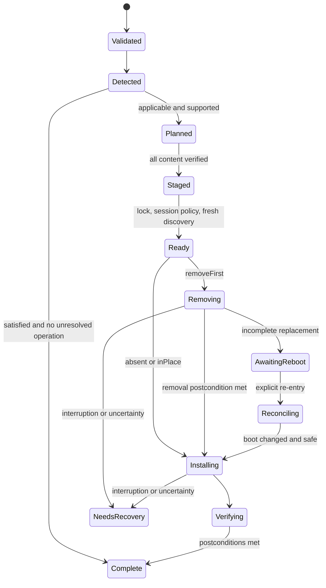

# Unified Windows installer foundation

Status: proposed architecture, 2026-11-02. This document specifies future behavior; it does not establish production support. Evidence baseline is main `40fb716`, PSAppDeployToolkit (PSADT) 4.1.8, and the separate, unmerged GSA proposal [PR 84](https://github.com/Relianco/device-scripts/pull/84), commit `db87fa6`. No Windows installation, reboot, session, or Intune pilot was performed for this design.

The proposed foundation is a small orchestration engine, typed package recipes, and thin delivery adapters. It should give standalone, RMM, and Intune deployments the same discovery, version policy, postconditions, and recovery semantics. PSADT remains the process and interaction toolkit. [Recipe specimens](../../design/unified-installer/recipes.md) and [acceptance scenarios](../../design/unified-installer/scenarios.md) are part of this proposal.

## Purpose and scope

An update must establish the desired application state, preserve useful recovery evidence, and tell the provider and user what actually happened. A zero process exit is insufficient. Removing a working networking client before discovering that its replacement cannot be retrieved is unacceptable. Installing into SYSTEM's profile when a user installation was intended is equally unacceptable.

V1 qualification targets three patterns: machine MSI installation/upgrades in place; reviewed machine EXE/Burn removal followed by replacement; and native standard-user EXE installation. Each recipe declares its supported operations. Install-new is the absent-state branch of `ensurePresent`; update means ensure present at least the target version. Uninstall, repair, exact-version enforcement, and reinstall are never inferred from file extension. The three specimens initially declare only `ensurePresent`.

Automatic downgrade, cross-scope migration, SYSTEM-to-user impersonation, multi-session user installation, all-user profile sweeps, mixed machine/user cleanup, MSIX provisioning, arbitrary dependency graphs, and universal uninstall-string interpretation are future work. V1 is not a deployment server, resident scheduler, configuration-management language, or replacement UI toolkit. It does not make every existing installer safe by wrapping it.

| Alternative | Benefit | Cost and decision |
| --- | --- | --- |
| Continue copied standalone packages | Minimal delivery change | Discovery and recovery keep diverging; retain only during migration. |
| Put orchestration in each provider | Uses provider-native workflows | Offline replacement and compliance differ between providers; reject as the common foundation. |
| General workflow DSL with arbitrary hooks | Broad installer coverage | Unbounded execution and replay semantics; defer. |
| Small engine with reviewed recipe primitives | Shared policy, bounded recovery, testable detection | Requires artifact generation and recipe qualification; recommended proposal. |

Existing evidence explains the boundary. The [runner](../../../windows/runner/Invoke-RelianRunner.ps1#L624-L677) delivers one script, not sibling modules. Its [Reinstall handling](../../../windows/runner/Invoke-RelianRunner.ps1#L376-L422) invokes Uninstall and Install separately and stops on nonzero. The [7-Zip planner](../../../windows/packages/7-zip/Invoke-7Zip.ps1#L62-L163) preserves newer versions, but its [discovery and marker fallback](../../../windows/packages/7-zip/Invoke-7Zip.ps1#L550-L600) can lose failure evidence. The new design preserves useful version intent while requiring actual postconditions.

## Contract and common semantics

Recipes are strict JSON data, interpreted by versioned, reviewed engine primitives. Reject unknown fields, duplicate keys, unsupported schema majors, out-of-range parameters, unresolved references, and incompatible engine versions before interaction or mutation. Minor schema extensions require an engine that explicitly recognizes them. There is no evaluated expression or executable command string in the recipe.

The specimens use this single proposed schema vocabulary:

| Field | Meaning and validation |
| --- | --- |
| `schemaVersion`, `recipeRevision`, `engineCompatibility` | Contract version, immutable recipe revision, supported engine major. Build provenance records the resolved recipe digest. |
| `qualification` | Release gate: only `passed` is publishable; specimens remain `pending`. Unresolved OS/identity/process fixtures block qualification. |
| `application` | Stable `id`, `channel`, vendor, and supported architecture. Display names alone are not identity. |
| `capabilities` | Explicit operation allowlist; absent capability means reject. |
| `context` | `executionIdentity` (`system` or `owningUser`), `installationScope` (`machine` or `user`), and `notificationAudience` (`none` or `eligibleSession`). These are independent. |
| `applicability` | Supported OS/architectures, enrollment safety, and required local prerequisites. Passing requirements does not mean compliant. |
| `desiredState` | Presence, target version, comparison policy, strategy, and downgrade policy. Exact content hashes do not imply exact installed-version enforcement. |
| `discovery` | A reviewed primitive plus explicit hive/view/scope and identity evidence requirements. No ambient HKCU resolution for machine recipes. |
| `payload` | Content source, SHA256, file type/version, signer constraint where required. A `releaseInput` source must be resolved into verified packaged content before publication. |
| `commands` | Reviewed command primitive, EXE token array or typed MSI properties, bounded timeout, accepted vendor codes, and restart suppression. No freeform runtime executable override. |
| `parameters`, `configuration`, `secretReferences` | Bounded typed nonsecret overrides, resolved desired configuration, and references to approved runtime secret channels. Empty collections are valid. |
| `postconditions`, `recovery`, `interaction` | Evidence for success, replay/compensation capabilities, reboot boundaries, process ownership and deferral policy. |

The request adds operation ID, action, authenticated invocation context, provider profile, target SID for user work, and allowed parameter values. These cannot override identity, scope, integrity pins, or executable locations. The release lock binds engine, recipe, discovery implementation, PSADT, brand, payloads, and generated artifacts by digest. Runtime requests carry references to that resolved release, not a mutable manifest URL.

For example, this is a proposed request object, not an existing runner interface. `releaseId` resolves through the adapter's trusted release catalog; `operationId` is illustrative. The specimen's `contentSource` enum chooses a preapproved location for the same pinned bytes. No caller-supplied executable, hash, command text, or scope is accepted.

```json
{
  "requestVersion": 1,
  "operationId": "example-operation-001",
  "releaseId": "gsa-2.34.222-r1",
  "operation": "ensurePresent",
  "profile": "standalone-machine",
  "parameters": { "contentSource": "packaged" }
}
```

Profiles are trusted adapter configuration: `standalone-machine` validates SYSTEM and eligible-session UX; `intune-machine` requires SYSTEM and Silent; `intune-user` requires the owning user and Silent. Selecting a profile grants no privilege and cannot override recipe scope. Bounded nonsecret application options are permitted only when declared; detection-relevant values become part of the resolved configuration digest. Sequencing remains recipe-owned regardless of request parameters.

Discovery has two layers. Read-only collectors produce observations with errors and provenance; a pure evaluator turns those observations and resolved recipe inputs into state and compliance. Both runtime and generated detection use the same collector/evaluator source revision. State is `Absent`, `Present`, `Unknown`, `Ambiguous`, or `Damaged`. Unknown includes unreadable registry/version evidence; ambiguous includes multiple incompatible identities or architectures; damaged means identifiable but inconsistent registration/files/health. None becomes absent through a catch-and-empty fallback. Record raw and normalized versions and every matched identity; never silently select the highest candidate. Markers and journals describe history, not installed product truth.

For `minimum`, equal/newer matching installations are satisfied without UI or mutation. `exact` with a newer installation is unsupported unless the recipe explicitly qualifies downgrade. Unexpected architecture, coexistence, damaged registration, or an unreadable version blocks destructive planning. Repair requires its own capability and postconditions. Configuration compliance is evaluated only for declared, observable configuration; installer arguments alone cannot prove it.

## Plan and execute

`Plan` is read-only: validate input, collect evidence, inspect existing active-operation/recovery records, evaluate applicability/compliance, and return proposed stages and unresolved preflight requirements. An unresolved prior operation takes precedence over runtime `AlreadySatisfied`, even when current product evidence looks compliant; read-only planning reports reconciliation required. Product detection itself remains journal-independent. Plan performs no download, journal write, process closure, PSADT session, or mutation. A plan is an explanation, not a durable authorization to act on stale observations.



Execution first proves free space, permissions, payload integrity, supported installer commands, and availability of everything needed after removal. Stage engine, recipe, toolkit, branding, replacement, and required dependency content before destructive work. Validate every old uninstaller and preserve necessary vendor cache layout; a copied EXE alone may not be sufficient. Hash mismatch is terminal and never retried. Reject URL userinfo before any download, including disabled legacy requests. Retry only bounded transient downloads before mutation, read-only probes, or a recipe-proven no-effect operation. Installer failure does not imply safe retry.

Use one protected machine mutation lock; user mutations use application-and-SID locks. A persistent active-operation record also reserves the application/scope across reboot. Do not hold a live lock while a user defers. Reacquire it and re-detect before mutation. External MSI contention remains possible: bounded waiting may produce `Busy`; never terminate another installer's processes. A different-version request cannot interleave with active replacement.

Before mutation, a newer authorized request may supersede a planned/staged request after releasing its references and creating a fresh plan. After destructive change, preserve the original immutable operation and finish/reconcile it first; return `Busy` with the active operation reference to the newer request. Reusing an operation ID with different recipe/configuration digests is invalid. Supersession is not permission to reinterpret old checkpoints with new code.

Cancellation before destructive work returns `Cancelled` with unchanged product state. After removal starts, cancellation is a stop request at a safe boundary: report incomplete work and `NeedsRecovery` or `PartialFailure`, retaining content. Do not kill an installer mid-write to honor a UI button. If it is already running, wait within its qualified timeout and reconcile. A timeout with possible surviving child processes is unknown outcome, not permission to launch again.

## Durable state and reboot boundaries

Persist an atomic, access-protected journal before each destructive command: operation and release digests, scope/SID, intended primitive, attempt, phase, boot identity, observed precondition, and expected postcondition. After execution, record raw process result and fresh observations. A crash between intent and completion becomes `NeedsReconciliation`. Re-entry verifies journal schema/content, locks the scope, checks surviving processes, recollects product evidence, and resumes only a transition proven safe by the recipe. A stale mutex or absent process does not prove the command never ran.

Removal 3010 records `RebootRequiredIncomplete` and `AwaitingReboot(next=Install)`. Same-boot re-entry repeats neither removal nor installation. After a confirmed boot change, validate retained content and discovery before proceeding. Removal 1641 means a restart was initiated; intent must already be durable, and the adapter must not race it with another restart. Install 3010 can produce `CompleteRebootRequired` only if declared postconditions are already satisfied; otherwise retain incomplete state until post-reboot verification. [Windows Installer codes](https://learn.microsoft.com/en-us/windows/win32/msi/error-codes) describe restart/cancellation/contention, not transaction completion.

V1 supports explicit/provider re-entry using a protected resume entry point and operation ID. It does not promise autonomous after-reboot execution. The provider or operator must arrange that invocation; user recovery requires the same owning user. Intune recipes needing intermediate reboot continuation are blocked before removal until a separate continuation mechanism has passed lab qualification. A 3010 mapping alone never establishes continuation.

Keep incomplete operations' verified payloads and engine versions until recovery or explicit administrative abandonment. Terminal unreferenced content can expire under bounded retention. Disk pressure must fail preflight or request recovery; it must not silently evict the only replacement after removal. Rollback exists only when a recipe supplies a tested compensation artifact, data/configuration strategy, postconditions, and supported reversal points. The three initial specimens promise no rollback.

## Outcome and transport contract

Every execution produces a structured result with `outcome`, `reason`, `phase`, `operationId`, `desiredStateSatisfied`, `mutationStarted`, `rebootRequired`, `retryEligible`, raw vendor/toolkit code, and safe diagnostic references. Provider exit codes are projections; logs and result files preserve distinctions. Failure to write the result prevents mutation during preflight; failure afterward requires recovery reporting, never fabricated success.

The following codes are proposed engine-protocol codes, not existing runner behavior or PSADT defaults. The legacy adapter retains its old contract until explicitly migrated.

| Outcome | Engine exit | Intune mapping/profile |
| --- | --- | --- |
| `Succeeded`, `AlreadySatisfied` | 0 | Success, only with satisfied postconditions. |
| `CompleteRebootRequired` | 3010 | Soft reboot; Intune owns restart. |
| `RebootRequiredIncomplete` | 69010 | Failure and recovery escalation; not a production v1 Intune path. |
| `Deferred` | 69011 | Failure; interactive deferral excluded in Intune. RMM schedules its own next attempt. |
| `Cancelled` | 69012 | Failure; preserve stage and cause. |
| `Busy`, `Retryable` | 69013 | Retry only when no unsafe mutation/replay is possible. |
| `BlockedBySession`, `BlockedByRunningProcess` | 69014 | Failure; assignment/deadline policy must arrange later invocation. |
| `NotApplicable`, `UnsupportedOperation` | 69015 | Requirements should normally exclude; runtime guard remains failure. |
| `NeedsRecovery`, `PartialFailure` | 69016 | Failure, no automatic replay. |
| `InvalidRequest`, `IntegrityFailure`, `Failed` | 1 | Failure. |

`PartialFailure` means a known completed destructive substep followed by failed work; `NeedsRecovery` also covers uncertain outcomes. The result reason distinguishes discovery unknown, damage, ambiguity, timeout, and session failure. No raw 1641 is blindly advertised as complete. If a qualified operation initiated restart and postconditions are satisfied, its eventual result can map to complete reboot; otherwise reconciliation governs.

PSADT 4.1.8 defaults are defer 1602 and timeout 1618, as its [configuration](https://github.com/PSAppDeployToolkit/PSAppDeployToolkit/blob/4.1.8/src/PSAppDeployToolkit/Config/config.psd1#L107-L117) shows. Toolkit session initialization failure can also use the defer code. Record controlled UI decisions/stage explicitly; an unexplained 1602 is a failed/unknown session result, not proof of “Later.” Vendor 1602 with known cancellation is `Cancelled`; verified MSI contention is `Busy`. Intune's [retry behavior](https://learn.microsoft.com/en-us/intune/app-management/deployment/add-win32) is three attempts five minutes apart; it cannot represent arbitrary deferral deadlines.

## Identity, storage, and execution security

V1 machine recipes require SYSTEM and protected ProgramData storage; interactive elevated-administrator execution needs a separately declared and qualified identity profile. User operations run naturally as the owning standard user, store state/cache/logs beneath that user's local application data, and never self-elevate. A user assignment does not turn a SYSTEM installer into a user installer. Machine discovery explicitly selects HKLM registry views; user discovery binds HKCU and filesystem roots to the verified caller SID. Never interpret SYSTEM's HKCU as the intended user's hive.

Establish ACLs before writing machine artifacts. Reject unsafe preexisting directories, traversal, absolute archive paths, reparse-point escapes, and writable privileged executable targets. Download into private partial files, verify, and atomically promote by digest; reverify on resume. User state is not trusted by a later SYSTEM execution. Journals contain enums, identifiers, and data; executable paths/arguments are reconstructed from the pinned release. A journal cannot inject PowerShell, change scope, or choose a new executable. A colocated checksum is not authentication.

Executable hooks are engine-owned reviewed source, pinned in the release. Untrusted runtime arguments pass only declared type/enum/range/length checks. Keep EXE tokens and MSI properties structured until a tested renderer builds the Windows command line. [Start-Process joins argument arrays](https://learn.microsoft.com/en-us/powershell/module/microsoft.powershell.management/start-process#-argumentlist), so arrays alone do not establish quoting safety. Test spaces, quotes, empty values, trailing slashes, Unicode, and MSI properties. Do not evaluate shell expressions or execute registry `UninstallString` verbatim.

Secrets resolve only through approved execution-context channels; recipes, generated detection, journals, and engine arguments contain references, never secret values. Prefer vendor-supported protected input files or stdin. V1 excludes installers requiring command-line secrets. PSADT's logging switches cannot universally hide process command lines. Redact credentials, URL query values, and exception text containing URLs from logs, result files, and telemetry. No provider API or tenant credential belongs in the engine.

## Delivery and reproducibility

Modular source must be reconciled with the existing one-script runner. Deterministic generated single-script packages would preserve that transport and could embed recipe and common functions, but duplicate the engine across artifacts, complicate resource delivery, and still need a release closure for toolkit/brand/offline payloads. Versioned content bundles make that closure explicit and support retained recovery content. Recommend bundles with an explicit new format/version selector; never silently reinterpret an existing script URL as a zip.

The new runner path verifies a bundle SHA256 before extraction, validates its manifest, and invokes its pinned entry point. Keep the legacy path, empty-hash no-op, URL-userinfo rejection, and no retry on integrity failure. V1 bundle calls use the new outcome protocol, including an atomic reinstall transaction only when a future recipe declares it; they do not inherit the legacy two-child Reinstall behavior.

A reproducible build resolves recipe/configuration once, orders archive entries, fixes timestamps, and emits a release lock, bundle digest, detector digest, and provenance. Include exact engine/discovery source, PSADT [4.1.8 pin](../../../windows/releases/psadt.json#L1-L8), brand digest, and payload identities. Intune packages materialize the complete closure, including offline payloads. Standalone bundles may retrieve separately pinned payloads before mutation. No runtime imports from live main, ambient modules, or “latest” URLs. Build repeatability and integrity tests gate publication; binaries remain release artifacts, not committed repository files.

## PSADT and user experience

The engine decides applicability, plan, session eligibility, content safety, recovery, and outcome. PSADT provides session, welcome, progress, process, and optional restart primitives. Use a supervised child session so toolkit host exit cannot erase the parent journal/result. Pass explicit deployment mode and success/reboot code policy rather than relying on Auto.

Verified 4.1.8 APIs include `Open-ADTSession` with `DeployMode`, opt-in `RequireAdmin`, `AppSuccessExitCodes`, and `AppRebootExitCodes`; `Show-ADTInstallationWelcome` with typed `CloseProcesses`, `AllowDefer`, `DeferTimes`, `DeferDeadline`, and `DeferRunInterval`; and `Show-ADTInstallationProgress` with `StatusMessage`, `StatusMessageDetail`, and nullable percentage. Welcome `CustomText` uses configured strings; `ForceWelcomeText` does not exist. See pinned [session](https://github.com/PSAppDeployToolkit/PSAppDeployToolkit/blob/4.1.8/src/PSAppDeployToolkit/Public/Open-ADTSession.ps1#L164-L363), [welcome](https://github.com/PSAppDeployToolkit/PSAppDeployToolkit/blob/4.1.8/src/PSAppDeployToolkit/Public/Show-ADTInstallationWelcome.ps1#L170-L712), and [progress](https://github.com/PSAppDeployToolkit/PSAppDeployToolkit/blob/4.1.8/src/PSAppDeployToolkit/Public/Show-ADTInstallationProgress.ps1#L80-L109) sources.

`Start-ADTProcess` supplies waits and logging controls; `SecureArgumentList` and `NoStreamLogging` address different logging paths. `Start-ADTMsiProcess` can [skip an install whose ProductCode is already present](https://github.com/PSAppDeployToolkit/PSAppDeployToolkit/blob/4.1.8/src/PSAppDeployToolkit/Public/Start-ADTMsiProcess.ps1#L456-L478), returning 1638. The command primitive must qualify same-ProductCode updates/repair rather than assume a transparent msiexec wrapper. User installation does not use `Start-ADTProcessAsUser` or linked/highest tokens in v1.

| Presence and provider | Policy before mutation |
| --- | --- |
| Standalone/RMM, one confirmed unlocked eligible session | One welcome, explicit action/disruption, manual process closure by default. Recheck eligibility and ownership before acting. |
| Confirmed no user | Machine work may run silently if disruption/process policy permits. User work waits for its owning context. |
| Locked, disconnected, unknown presence, or multiple affected users | `BlockedBySession`; one person's acceptance cannot authorize closing another's work. |
| OOBE/device ESP/user ESP | No blocking UI or local restart countdown; only declared enrollment-safe silent recipes proceed. |
| Intune | Silent execution and provider notifications; same process safety gates, no forced interactive-session workaround. |

Toolkit active-session selection is not proof of an unlocked desktop or consent; its [selection implementation](https://github.com/PSAppDeployToolkit/PSAppDeployToolkit/blob/4.1.8/src/PSAppDeployToolkit/Private/Get-ADTRunAsActiveUser.ps1#L55-L76) must not become application policy. Never call Welcome merely to inspect processes in Silent mode: its [closure path](https://github.com/PSAppDeployToolkit/PSAppDeployToolkit/blob/4.1.8/src/PSAppDeployToolkit/Public/Show-ADTInstallationWelcome.ps1#L1154-L1279) can force-close them.

Interaction policy declares process allowlist/ownership, bounded wait, optional deferral count, absolute UTC deadline, retry interval, and post-deadline behavior. Default deadline action is block and report; force-close needs explicit reviewed authorization and Windows proof. Stable deployment identity shares deferral history across retries, separately for each action and user. User-writable PSADT history is convenience state, not authoritative deadline enforcement. Offer “Later” only when the adapter actually schedules retry. Busy microphone/presentation may delay optional notices; suppression is never consent.

Show actual phases: downloading, verifying content, waiting for process closure, removing, installing, verifying installation. Use indeterminate progress without measurable telemetry. Complete copy requires postconditions; intermediate reboot says “Restart required before installation can continue.” Failure after removal says the previous version was removed and replacement failed, with a real recovery reference.

Exactly one restart owner is selected in the adapter. Suppress vendor restarts where supported; record unexpected initiated restart as such. Intune owns restart behavior. Standalone/RMM may delegate after journaling to a separately qualified restart controller. `Show-ADTInstallationRestartPrompt` is not a harmless notice: its [implementation](https://github.com/PSAppDeployToolkit/PSAppDeployToolkit/blob/4.1.8/src/PSAppDeployToolkit/Public/Show-ADTInstallationRestartPrompt.ps1#L191-L278) can schedule restart, and session display is asynchronous. Do not combine that controller with provider countdowns.

## Intune generation and ownership

Resolve recipe, release lock, and nonsecret deployment configuration together. Emit complete content, action-only entrypoints, standalone detection, and reviewable Graph metadata. Intune publication requires a qualified `ensureAbsent` capability and real uninstall entrypoint; the initial ensure-present specimens cannot yet be published as Intune apps. Do not generate a dummy/no-op uninstall. Detection contains the same discovery/evaluation code and a safely serialized projection of resolved identity/version/scope/configuration. It works before install without toolkit, network, or package cache. Install arguments are unavailable to detection; the [Graph script rule](https://learn.microsoft.com/en-us/graph/api/resources/intune-apps-win32lobapppowershellscriptrule?view=graph-rest-1.0) provides script content, not an argument channel.

Detection emits exactly one success token and exit zero only when desired state is satisfied; otherwise nonzero with no success stdout. Keep diagnostics out of stderr on success. Requirements separately express OS, architecture, and execution applicability. Generated install behavior and detector context must match: machine/SYSTEM or owning-user/User. Do not invent an independent detection `runAsAccount`; use app [install experience](https://learn.microsoft.com/en-us/graph/api/resources/intune-apps-win32lobappinstallexperience?view=graph-rest-1.0). User recipes use user targeting in v1. Generate explicit 64-bit launching from a 32-bit agent where required, set detection bitness accordingly, and still use explicit registry views. Unsupported architectures fail applicability.

Microsoft's current [Win32 app guidance](https://learn.microsoft.com/en-us/intune/app-management/deployment/add-win32) excludes interactive installations. Supported Intune v1 therefore uses Silent and provider notifications, not PSADT deferral dialogs. It also excludes guaranteed unattended intermediate-reboot replacement until a continuation owner is separately proven; fail capability preflight before removal, even when a particular run might avoid reboot.

The adapter owns assignments, tenant app IDs, dependencies, supersedence, deadlines, notification settings, restart configuration, and code mapping. Recipes own local prerequisite checks and replacement phases. Choose one upgrade/removal owner per release: recipe-managed GSA removal disables supersedence's uninstall-previous switch; provider-managed removal requires a recipe that does not also remove. [Supersedence](https://learn.microsoft.com/en-us/intune/app-management/deployment/configure-win32-supersedence) does not itself target the new app. Provider dependencies install separately; local discovery verifies prerequisites and never silently downloads another app. Configuration changes regenerate runtime and detector together.

The separate `Relian-CIPP/scripts/deploy-win32-app.py` currently accepts independent command/detector inputs (lines 135–189), hardcodes context/requirements, and hides assignment notifications (215–222). Adapter work belongs there after engine qualification, consuming generated artifacts instead of reimplementing recipe policy. This proposal makes no provider changes.

## Phased migration and release gates

| Phase | Deliverable and exit criterion |
| --- | --- |
| P0 — contract | Review this proposal, finalize schema/result codes, trace every specimen to evidence, and resolve release blockers explicitly. |
| P1 — pure engine/build | Offline plain PowerShell tests prove schema, discovery/evaluation parity, planner, argument rendering, outcome mapping, journal transitions, malicious input rejection, and deterministic generation. Mutation tests prove critical checks matter. |
| P2 — Windows qualification | Authorized isolated VMs prove all three specimens, actual interruption/reboot/offline recovery, ACLs, user scope, session behavior, and postconditions. Unsupported paths remain gated. |
| P3 — runner coexistence | Introduce explicit bundle protocol alongside legacy scripts. Pilot allowlisted releases with known recovery procedures and retained artifacts; observe failures and rollback rollout before expanding. |
| P4 — Intune adapter | Separate CIPP change consumes generated machine/user content and detection. Lab validates provider context, bitness, return codes, notifications, and reboot limits before tenant pilot. GSA intermediate reboot remains excluded without continuation proof. |
| P5 — broader scope | Qualify further recipes individually; mixed scope, MSIX, cross-user management, repair/downgrade, and autonomous resume require separate designs. |

Rollout rollback disables new assignments/bundle selection and preserves legacy availability for unaffected devices. It does not downgrade applications or discard active-operation records. Devices already mutated finish/recover with their pinned release; never route them blindly through legacy reinstall. Phase exit requires the [scenario matrix](../../design/unified-installer/scenarios.md), evidence artifacts, and no unowned recovery path. Pure tests are offline `pwsh` scripts without Pester; they cannot certify Windows installer behavior. This document is the architecture input to a later implementation plan, not authorization to run an installer.
